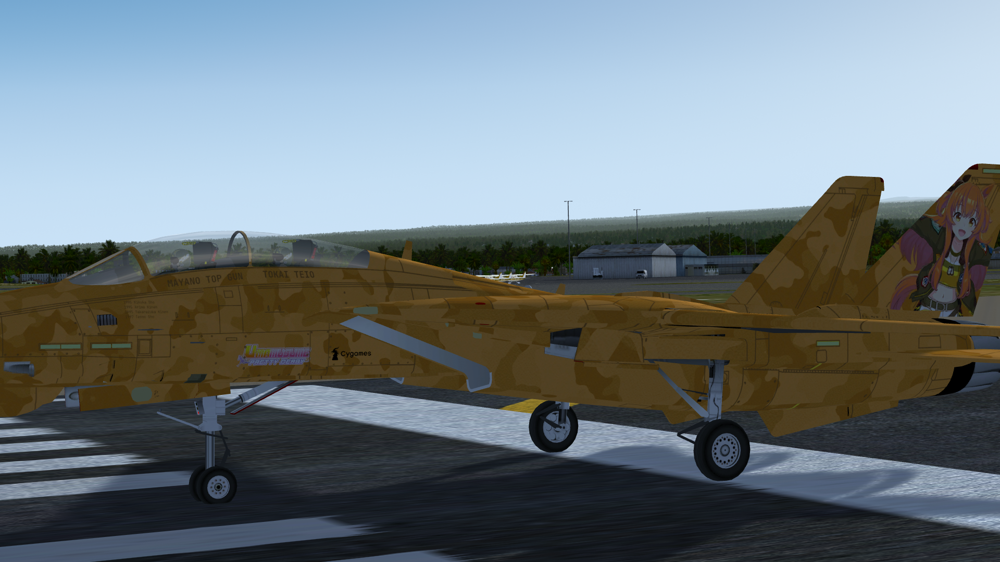
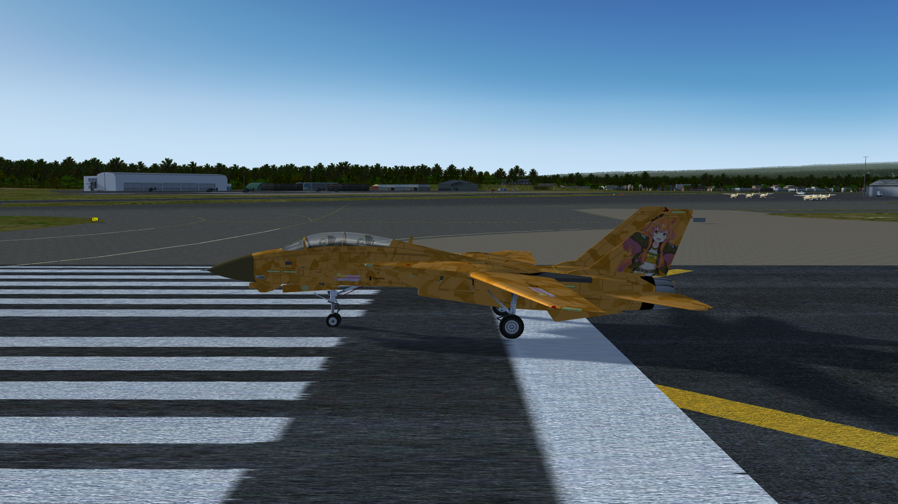

# F-14B Tomcat — Mayano Top Gun Livery (FlightGear)

A custom fan-made orange camouflage livery for the **Grumman F-14B Tomcat** in **FlightGear**, inspired by **Mayano Top Gun** from *Umamusume: Pretty Derby* and dedicated to the real-life racehorse (1992–2019).

* **Author:** cursewalker04
* **Target Aircraft:** F-14B Tomcat (`f-14b`)
* **Simulator:** FlightGear

---

## Livery Details
* **Airframe Paint:** Custom orange camouflage scheme.
* **Tail Art:** Vertical stabilizer artwork featuring Mayano Top Gun.
* **Cockpit & Canopy Rails:** Custom helmet design alongside **Mayano Top Gun** and **Tokai Teio** name markings on the airframe.
* **Kill Marks:** Career race win markings placed in the traditional kill-mark location below the cockpit.
* **Wings:** Custom decals on one wing, Mayano Top Gun's in-game unique skill/ability text on the opposite wing, and *"RIP Mayano Top Gun 1992–2019"* memorial text along the rear edge.
* **Fuselage Decals:** *Umamusume: Pretty Derby* and Cygames logos.

---

## Installation
1. Download or clone this repository.
2. Locate your FlightGear `f-14b` aircraft directory (`Aircraft/f-14b/`).
3. Copy or merge the `Liveries` folder from this repository directly into `Aircraft/f-14b/Models/` so the path looks like:
   ```text
   Aircraft/f-14b/Models/Liveries/



